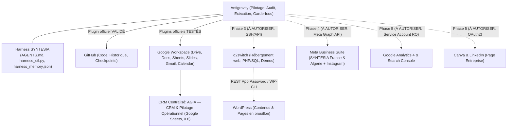

# ARCHITECTURE DE CONNECTIVITÉ OPÉRATIONNELLE SYNTESIA (AGIA-014)

**Date :** 2026-11-21  
**Principe :** Centraliser le pilotage dans Antigravity sans multiplier les abonnements payants (`F1 = 0,00 €`), en s'appuyant d'abord sur les outils déjà connectés.

## Rôle de chaque brique dans l'architecture unifiée

1. **Antigravity (Poste de pilotage)** : orchestre les tâches, vérifie les prérequis (`preflight`), exécute les lectures/préparations et soumet toute action externe engageante à validation humaine.
2. **Harness SYNTESIA** : garantit la mémoire persistante (`harness_memory.json`), les règles (`F1`, `WEBHOOK_ENABLED=false`), les permissions et les checkpoints (`CP-AGIA-*`).
3. **GitHub (`naitconv-web/agia-infrastructure`)** : source de vérité unique du code, des livrables et des procédures.
4. **Google Workspace + CRM Google Sheets (`1EmC6f4ljLU2GZmD9HEBt50WdTlVXoQtPQ64vFQL1I_0`)** : socle documentaire, e-mails, agenda et CRM commercial déjà opérationnel à `0,00 €` (aucun CRM tiers payant nécessaire).
5. **o2switch + WordPress** : socle d'hébergement web et CMS (à connecter uniquement après réception de l'inventaire cPanel et autorisation SSH/Application Password).
6. **Meta Business Suite (Facebook + Instagram)** : gestion centralisée des deux futures pages `SYNTESIA France` et `SYNTESIA Algérie` et de leur messagerie, via System User sans création de faux comptes.
7. **GA4 / Search Console / Canva / LinkedIn** : briques complémentaires connectées uniquement en lecture seule ou préparation de brouillons, au rythme d'un service à la fois.
