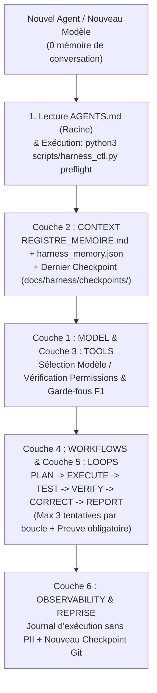

# LIVRABLE 2 — ARCHITECTURE CIBLE DU SYNTESIA HARNESS ENGINEERING (6 COUCHES)

**Référence :** SYNTESIA-HARNESS-ARCH-011 (Mission AGIA-011)  
**Date :** 21 novembre 2026  
**Dépôt de référence unique :** `naitconv-web/agia-infrastructure` (branche `main`)  
**Philosophie d'ingénierie :** *Zéro dépendance à la mémoire conversationnelle · Zéro démon lourd · Fichiers versionnés + Contrôleur Python déterministe (`scripts/harness_ctl.py`) · Sobriété maximale en tokens.*

---

## 1. CHOIX STRUCTURANTS & JUSTIFICATION TECHNIQUE

Conformément à la contrainte *« Ne pas développer une nouvelle application si des fichiers structurés et des scripts suffisent »* et à la doctrine *Lean v1.0 / Bus Lean v3.0* du fondateur :
1. **Le système de fichiers Git EST la mémoire d'état :** Aucune base de données externe payante, aucun serveur Docker résident, aucun framework lourd n'est introduit. Tout l'état du Harness réside dans `docs/harness/` (Markdown lisible par l'humain et par tout LLM + état structuré `docs/harness/state/harness_memory.json` vérifiable par script).
2. **Point d'entrée unique à la racine (`AGENTS.md`) :** Tout agent (Antigravity, Claude Code, OpenCode, Mistral Vibe via Paseo, Gemini CLI ou ChatGPT) qui ouvre le dépôt lit automatiquement `AGENTS.md` en premier. Ce fichier fait moins de 120 lignes pour minimiser la consommation de tokens au démarrage (*Progressive Disclosure*) et oriente l'agent vers le **Shards** pertinent.
3. **Contrôleur déterministe sans dépendance (`scripts/harness_ctl.py`) :** Un script Python 3 standard (0 dépendance `pip`) exécute en `< 1 seconde` le préflight (`preflight`), la détection de contradictions (`check-conflicts`), la génération de checkpoint (`checkpoint`) et la batterie des 6 tests de résilience (`test-resilience`).

---

## 2. SPÉCIFICATION DÉTAILLÉE DES SIX COUCHES DU HARNESS

### COUCHE 1 — `MODEL` (Sélection Agnostique, Quotas & Continuité Inter-Modèles)

Aucun projet SYNTESIA ne dépend d'un fournisseur unique de LLM. Le routage des tâches suit une matrice de sélection fondée sur 5 critères (nature de la tâche, capacités, fiabilité, coût/quota, reprise) :

| Profil de tâche | Environnement / Modèle Primaire | Environnement / Modèle de Repli (Failover Quota) | Règle d'économie de Quota & Format de Reprise |
| :--- | :--- | :--- | :--- |
| **1. Orchestration lourde, Ingénierie multi-fichiers, Recette navigateur CDP & Git/Drive** | **Antigravity Cloud** (Abonnement Google AI Pro — `S-01`) | **Paseo Local + OpenCode / Mistral Vibe** (`S-05` / `L-01`) sur poste fondateur | • Si le quota tombe `< 25 %` : passer immédiatement en **Mode Exécution Minimale** (grouper les écritures, 0 recherche exploratoire secondaire, checkpoint immédiat). • Le checkpoint `CP-<MISSION>.json` est 100 % agnostique du modèle. |
| **2. Contre-Audit indépendant, Revue stratégique & Critique Red-Team (`Concepteur != Auditeur`)** | **ChatGPT Go** (Abonnement OpenAI — `S-04`) | **Google AI Studio** (`S-02`) avec prompt `ec-auditor` / `Reality Checker` | • Règle absolue : le modèle qui audite une phase critique ne doit pas se contenter du résumé conversationnel du modèle concepteur ; il inspecte le fichier de preuve ou le checkpoint Git. |
| **3. Tâches déterministes répétitives (Validation CRM, Scoring, Audit KPI, Vérification de liens, Préflight)** | **Scripts Python / Node.js locaux (`0 token LLM`)** (`harness_ctl.py`, `orchestrate_crm.py`, `audit_kpi_sync.py`, `communication_gate.py`) | Exécution CLI directe | • **Règle d'or :** Ne jamais dépenser de tokens LLM pour un calcul ou une vérification qu'un script Python déterministe exécute gratuitement en 50 millisecondes. |

---

### COUCHE 2 — `CONTEXT` (Mémoire Persistante Structurée en 6 Piliers & Statuts Explicites)

La mémoire du portefeuille est gouvernée par **[REGISTRE_MEMOIRE.md](file:///home/antigravity/agia-infrastructure/docs/harness/REGISTRE_MEMOIRE.md)** et son miroir vérifiable **[docs/harness/state/harness_memory.json](file:///home/antigravity/agia-infrastructure/docs/harness/state/harness_memory.json)**. Elle est divisée en **6 sections obligatoires** :
1. **`FACTS`** : Faits techniques, juridiques ou commerciaux vérifiés avec leur preuve.
2. **`DECISIONS`** : Décisions stratégiques et architecturales arbitrées par le fondateur (`WS-2026-*`, `AGIA-*`, `D-011`).
3. **`TASKS`** : Tâches accomplies, en cours ou reportées au backlog (`AGIA-010+`).
4. **`PROJECTS`** : État isolé de chaque projet du portefeuille (`SYNTESIA`, `LAB`, `WORKSTATION-IA`, `OMNISECUR`, `RELANCE-DEVIS / OMNIRENOV`, `OMNIPATRIMOINE`, `AMBRESSENCE`, `ATLAS GLOBAL TRADING`, `EMERGENCY CASHFLOW`).
5. **`SHARDS`** : Index des documents spécialisés à charger *uniquement à la demande* (évitant de saturer la fenêtre de contexte).
6. **`SOURCES`** : Provenance exacte (chemin fichier Git + commit SHA, ou ID Google Drive + SHA-256).

#### Taxonomie obligatoire des 6 statuts de mémoire (Interdiction de promotion silencieuse)
Chaque entrée de la couche `CONTEXT` porte obligatoirement l'un des 6 statuts normalisés suivants :
- **`CONFIRMED`** : Fait ou décision prouvé par une source primaire consultée ou un test exécuté avec trace (`CONFIRMÉ PAR SOURCE` / `VÉRIFIÉ TECHNIQUEMENT`).
- **`DECLARED`** : Information déclarée dans un document dont la preuve sous-jacente n'est pas directement accessible depuis l'environnement courant (ex. état du PC local Windows 11 ou dépôt Git en `HTTP 403`).
- **`PROPOSED`** : Spécification cible, recommandation ou hypothèse soumise à l'arbitrage du fondateur (ex. feuille de route Phase 2 `OMNISECUR` ou cible `< 80 Mo RAM` de `lab-core`).
- **`IN_PROGRESS`** : Travail ou formalité engagé mais non achevé (ex. constitution de la SASU `ATLAS GLOBAL TRADING`).
- **`BLOCKED`** : Élément arrêté par une dépendance externe, une absence d'autorisation ou une contradiction documentaire non tranchée (ex. mise en ligne publique bloquée tant que `WEBHOOK_ENABLED = false` et Mentions Légales non complétées).
- **`SUPERSEDED`** : Ancienne décision ou mention remplacée par une décision plus récente (conservée pour la traçabilité historique, jamais exécutée).

---

### COUCHE 3 — `TOOLS` (Inventaire des Outils, Permissions, Limites & Garde-Fous)

| Outil / Interface | Accès & Permissions dans la VM | Limites & Dépendances techniques | Risques & Garde-Fous obligatoires |
| :--- | :--- | :--- | :--- |
| **1. GitHub (`git` & `gh` CLI)** | Connecté via `agy-plugin-proxy` OAuth. Lecture/écriture complète sur `naitconv-web/agia-infrastructure`. | Les 6 autres dépôts privés du compte (`omnisecur`, `ec-mission-state`...) renvoient `HTTP 403` tant qu'ils ne sont pas attachés aux ressources du projet. | • **Interdiction de `git push --force` ou d'écrasement d'historique.** • `git status` et `git log` obligatoires avant et après chaque mission. |
| **2. Google Drive & Workspace (`gdrive`, `gdocs`, `gsheets`, `gmail`, `gcalendar`)** | Connectés et authentifiés dans `/opt/antigravity/bin`. | • Syntaxe CLI migrée vers les sous-commandes préfixées (`gsheets readonly read`, `gsheets mutate append`). • Pas de CLI `clasp` pour déployer un Web App Google Apps Script à distance. | • **Lecture seule stricte** sur `WORKSTATION-IA/_KNOWLEDGE_BASE/` et les dossiers des autres projets. • Dans le CRM `1EmC6f4ljLU2GZmD9HEBt50WdTlVXoQtPQ64vFQL1I_0`, toute écriture de test doit porter `Environnement = TEST`. • **Interdiction absolue d'envoyer un e-mail via `gmail` à un prospect sans ordre explicite.** |
| **3. Terminal Linux & Runtimes (`python3`, `node v24`, `bash`)** | Utilisateur `antigravity` dans sandbox `exebox`. Écriture autorisée dans `/home/antigravity` et `/tmp`. | Pas d'accès `root` / `sudo` / `apt`. Sortie réseau filtrée par `agy-plugin-proxy`. | • Privilégier les scripts Python/Node.js sans dépendance externe. • Ne jamais stocker ou afficher de secret dans `stdout` ou dans un fichier suivi par Git. |
| **4. Navigateur Headless (`/usr/bin/chromium` + CDP WebSocket)** | Disponible localement (`/usr/bin/chromium --headless --no-sandbox --disable-gpu`). | Fonctionne à 100 % sur les fichiers locaux `file:///...` sans accès CDN externe grâce au CSS compilé en local. | • Utiliser systématiquement Chromium CDP pour vérifier le rendu visuel (`375, 768, 1024, 1440 px`) et l'exécution DOM/JS des formulaires et démonstrateurs. |
| **5. API Open Data État (`recherche-entreprises.api.gouv.fr`)** | Accessible en HTTPS lecture seule (`GET`). | Gratuite, sans clé API, limitée aux entreprises françaises immatriculées à l'INSEE. | • Usage strictement passif pour qualifier des entreprises cibles (SIREN, NAF, dirigeant RCS) sans déclencher aucun contact sortant. |

---

### COUCHE 4 — `WORKFLOWS` (Cycle de Travail Standardisé en 8 Étapes)

Toute mission SYNTESIA suit invariablement la séquence définie dans **[PROTOCOLE_PREFLIGHT.md](file:///home/antigravity/agia-infrastructure/docs/harness/PROTOCOLE_PREFLIGHT.md)** et **[PROTOCOLE_CHECKPOINT.md](file:///home/antigravity/agia-infrastructure/docs/harness/PROTOCOLE_CHECKPOINT.md)** :
1. **Étape 1 — Préflight & Récupération du contexte :** Exécution de `python3 scripts/harness_ctl.py preflight` (contrôle Git, lecture du dernier checkpoint, vérification d'absence de conflit bloquant).
2. **Étape 2 — Définition de l'objectif et des critères de réussite :** Formulation mesurable des livrables attendus et vérification des garde-fous (Régime F1 `0,00 €`, `WEBHOOK_ENABLED = false`, périmètre de fichiers autorisé).
3. **Étape 3 — Découpage en tâches atomiques :** Chargement *uniquement* des `SHARDS` nécessaires à la mission.
4. **Étape 4 — Exécution contrôlée :** Création ou modification chirurgicale des fichiers.
5. **Étape 5 — Tests et vérification par preuve :** Exécution des tests automatisés (Python / Node.js / Chromium CDP) avec capture du code retour et de la sortie.
6. **Étape 6 — Sas de Validation Humaine (lorsque requis) :** Arrêt obligatoire devant toute action irréversible, juridique, financière ou de publication externe.
7. **Étape 7 — Enregistrement des résultats & Commit Git :** Mise à jour de l'état et commit atomique non destructif.
8. **Étape 8 — Génération du Checkpoint de reprise :** Exécution de `python3 scripts/harness_ctl.py checkpoint --mission <ID>` enregistrant le point de reprise complet dans `docs/harness/checkpoints/`.

---

### COUCHE 5 — `LOOPS` (Boucles Contrôlées `PLAN → EXECUTE → TEST → VERIFY → CORRECT → REPORT`)

Définie dans **[PROTOCOLE_VALIDATION.md](file:///home/antigravity/agia-infrastructure/docs/harness/PROTOCOLE_VALIDATION.md)**, chaque boucle d'exécution obéit à 5 paramètres stricts :
- **Objectif mesurable :** Assertion binaire vérifiable par machine (ex. `0 lien brisé`, `20/20 viewports sans overflow`, `6/6 tests de résilience passés`).
- **Critère d'arrêt :** Code de sortie `0` du script de vérification **et** présence physique de la preuve (fichier, hash SHA-256 ou trace de test).
- **Limite de tentatives (`MAX_ATTEMPTS = 3`) :** Si une étape `TEST / VERIFY` échoue, l'agent entre en phase `CORRECT` pour au maximum **3 tentatives consécutives**.
- **Interdiction de déclaration sans preuve :** Le contrôleur `harness_ctl.py` refuse de promouvoir une tâche au statut `CONFIRMED` si le champ `proof_artifact` ou `verification_command` est vide ou non vérifié (`Test F`).
- **Procédure d'escalade en cas de blocage :** Après 3 tentatives infructueuses ou face à une ressource inaccessible (`HTTP 403`, outil non connecté, contradiction juridique), l'agent marque la tâche `BLOCKED`, génère immédiatement un checkpoint d'état et remonte le blocage factuel au fondateur sans boucler à vide (préservation du quota).

---

### COUCHE 6 — `OBSERVABILITY` (Traçabilité, Sobriété & Zéro PII dans les Journaux)

Chaque exécution du Harness alimente le journal structuré `docs/harness/state/execution_trace.jsonl` (et les métadonnées du checkpoint) en enregistrant :
- `timestamp_utc`, `mission_id`, `agent_runtime` (`Antigravity`, `Paseo/Vibe`, `Script-Deterministe`), `action_type` (`PREFLIGHT`, `CONFLICT_CHECK`, `RESILIENCE_TEST`, `CHECKPOINT`).
- `files_inspected`, `files_modified`, `commands_run`, `test_summary` (`passed / total`), `anomalies_fixed`, `decisions_recorded`, `quota_mode` (`STANDARD` ou `ECONOMY_LOW_QUOTA`).
- **Garde-fou de confidentialité (`Zéro Secret / Zéro PII`) :** `harness_ctl.py` applique un filtre automatique interdisant l'écriture de jetons (`ghp_`, `AIza`, `Bearer`) ou de coordonnées personnelles de prospects dans les journaux techniques.
