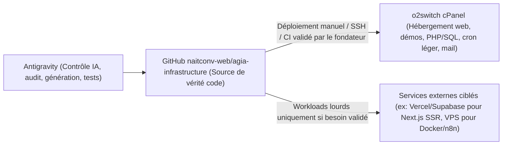

# ARCHITECTURE CIBLE SYNTESIA (ANTIGRAVITY + GITHUB + O2SWITCH)

**Date :** 2026-11-21  
**Principe directeur :** Séparer strictement le **contrôle IA** (Antigravity), la **source de vérité code** (GitHub), l'**hébergement web/données léger déjà financé** (o2switch), et les **services externes spécialisés** uniquement quand o2switch atteint ses limites structurelles.

## Rôle exact de chaque brique

1. **Antigravity (Cerveau & Orchestration — hors o2switch)**
   - Exécute les missions, audits, générations de livrables, tests navigateur et contrôles `harness_ctl.py`.
   - Ne nécessite aucun hébergement permanent sur o2switch.

2. **GitHub (`naitconv-web/agia-infrastructure` — Source de vérité)**
   - Contient l'ensemble du code, de la documentation, des démonstrateurs et de l'état Harness (`harness_memory.json`).
   - Aucun fichier ne doit être édité en production sur o2switch sans passer par Git.

3. **o2switch (Socle d'hébergement mutualisé `0 €` de surcoût)**
   - **Oui :** démonstrateurs clients HTML/JS (`sites/demonstrateur`), pages d'atterrissage en pause ou futures, endpoints PHP/SQL de collecte de leads, portails clients légers, tâches cron courtes, messagerie professionnelle.
   - **Isolation :** utiliser des sous-domaines dédiés (ou lunes si disponibles sur l'offre) pour séparer `ambressence.com`, les démos SYNTESIA et d'éventuels pilotes clients.

4. **Services externes (uniquement sur besoin client avéré et validé)**
   - Applications Next.js 15 SSR + Auth/Realtime (type `OMNISECUR`) : **Vercel + Supabase** (ou VPS dédié).
   - Automatisations persistantes / conteneurs (`n8n`, `Chatwoot`, workers Redis/Docker) : **VPS dédié** (hors mutualisé o2switch).
