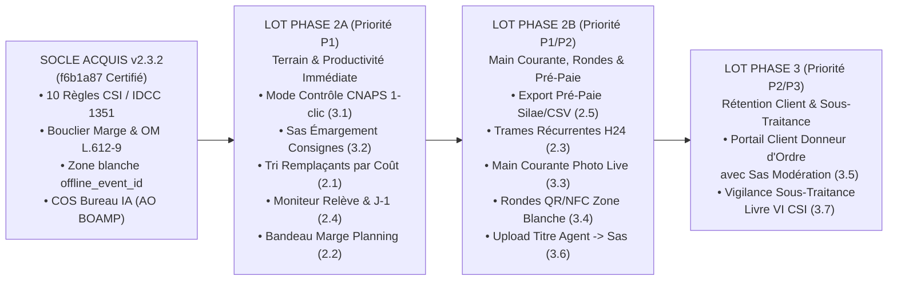

# MATRICE D'ADAPTATION CONCURRENTIELLE & PROPOSITION DE FEUILLE DE ROUTE — OMNISECUR (ÉTAPE D)
**Référence :** SYNTESIA-OMNI-BENCH-03 (Mission AGIA-007 — Chantier 2, Étape D)  
**Projet destinataire :** `OMNISECUR` (LAB Niveau 2 — Socle certifié `v2.3.2` commit `f6b1a87` & `COS Bureau IA`)  
**Cadre légal & conventionnel de filtrage :** Code de la Sécurité Intérieure (`CSI Livre VI`, notamment Art. L.612-9 et L.612-20), `CNAPS`, Convention Collective Nationale Prévention-Sécurité (`IDCC 1351 / Brochure JO 3196` + Avenant n° 2 plancher 6h), Code du travail (Art. L.3131-1) et Doctrine `CNIL` relative à la géolocalisation des employés (`SOURCES-REGLEMENTAIRES-DATEES.md`).  
**Date :** 21 novembre 2026  
**Statut :** `MATRICE D'ADAPTATION ÉTABLIE — PROPOSITION SOUMISE À ARBITRAGE DU FONDATEUR (AUCUNE MODIFICATION DU CODE SOURCE v2.3.2)`

---

## 1. SYNTHÈSE DES 4 CATÉGORIES DE FONCTIONNALITÉS AU REGARD D'OMNISECUR

Le croisement du benchmark mondial (28 solutions cartographiées, 10 approfondies) avec l'état technique réel d'`OMNISECUR v2.3.2` (`RAPPORT-CERTIFICATION-TECHNIQUE.md` et `00-cadrage-omnisecur.md`) conduit à classer les fonctionnalités en **quatre catégories strictement distinctes** :

1. **Catégorie 1 — Fonctionnalités déjà présentes dans `OMNISECUR v2.3.2` (Acquis à préserver)** : Fonctionnalités où `OMNISECUR` égale ou surpasse déjà les leaders mondiaux grâce à sa conformité déterministe française et son architecture Zero-Trust.
2. **Catégorie 2 — Fonctionnalités existantes à améliorer / enrichir dans `OMNISECUR`** : Briques déjà présentes dans le MVP (F0 à F8) dont l'ergonomie ou la profondeur algorithmique peut être hissée au niveau de *Celayix*, *Combo*, *SmartPS* ou *Progisap*.
3. **Catégorie 3 — Nouvelles fonctionnalités à forte valeur à adopter (Clean-Room Phase 2 & 3)** : Innovations observées chez *TrackTik*, *Silvertrac*, *OfficerApps*, *Guardhouse*, *Connecteam* et *QR-Patrol* qui renforceront l'avantage concurrentiel d'`OMNISECUR` en France.
4. **Catégorie 4 — Fonctionnalités non pertinentes ou illégales en France (Écartées délibérément)** : Pratiques courantes dans les logiciels nord-américains qui exposeraient un dirigeant français à des sanctions de la **CNIL**, de l'**Inspection du travail**, de l'**URSSAF** ou du **CNAPS**.

---

## 2. MATRICE COMPARATIVE D'ADAPTATION À OMNISECUR

### CATÉGORIE 1 — FONCTIONNALITÉS DÉJÀ PRÉSENTES ET CERTIFIÉES DANS `OMNISECUR v2.3.2`

| Fonctionnalité concurrente | Intérêt pour OMNISECUR | Difficulté | Priorité | Justification |
| :--- | :---: | :---: | :---: | :--- |
| **1.1. Blocage déterministe des titres expirés jusqu'à la fin de la vacation (`shiftEnd`)** *(Observé chez : Guardhouse, Progisap, TrackTik)* | **Critique** | **Déjà acquis (`v2.3.2`)** | **P0 — Acquis** | Déjà codé et testé dans `compliance-engine.ts` d'`OMNISECUR` : vérifie que la carte pro CNAPS et le MAC sont valides jusqu'à `shiftEnd` (`>=`), et le SST/SSIAP à la prise de poste (`shiftStart`), avec gestion du fuseau `Europe/Paris` (DST). |
| **1.2. Contrôle déterministe du repos quotidien (`>= 12h` conventionnel / `11h` légal dérogatoire), amplitude `12h`, plafond `48h/sem` et anti double-booking** *(Observé chez : SmartPS, Progisap, Celayix)* | **Critique** | **Déjà acquis (`v2.3.2`)** | **P0 — Acquis** | Déjà présent et certifié par les tests unitaires et d'intégration PostgreSQL d'`OMNISECUR` (`SORTIES-BRUTES-TESTS-ET-BUILD-f6b1a87.txt`). Surpasse les logiciels américains (*TrackTik/Silvertrac*) qui ignorent l'IDCC 1351. |
| **1.3. Pointage ponctuel avec protocole Zone Blanche (`offline_event_id`) et horodatage serveur infalsifiable (`clock_timestamp()`)** *(Observé chez : TrackTik, QR-Patrol)* | **Critique** | **Déjà acquis (`v2.3.2`)** | **P0 — Acquis** | Le socle PostgreSQL/Supabase d'`OMNISECUR v2.3.2` possède déjà l'index unique anti-rejeu `idx_shift_checkins_offline_event_id`, le rejet de l'heure téléphone falsifiable au profit de `clock_timestamp()` et le journal d'audit chaîné SHA-256. |
| **1.4. Simulateur de coût de revient horaire complet et Prix Plancher (« Bouclier Marge ») avec plancher 6h (Avenant n° 2)** *(Partiellement observé chez : TrackTik, Timegate)* | **Critique** | **Déjà acquis (`v2.3.2`)** | **P0 — Acquis** | Déjà présent dans `cost-engine.ts` d'`OMNISECUR` avec verrouillage strict : aucun calcul n'est autorisé tant que `costParamsVerifiedByDirector === true`. |
| **1.5. Génération d'Ordre de Mission conforme à l'Art. L.612-9 du CSI avec Sas de validation Dirigeant** *(Spécificité française absente des SaaS US/UK)* | **Critique** | **Déjà acquis (`v2.3.2`)** | **P0 — Acquis** | Déjà opérationnel dans le socle et la Démo Phase 1 d'`OMNISECUR` : tout remplacement reste en brouillon tant que le dirigeant ne l'a pas validé dans le Sas. |
| **1.6. Veille et atelier multi-agents d'Appels d'Offres Publics (`BOAMP / DECP`)** *(Absent chez les 10 concurrents étudiés !)* | **Critique (Différenciateur exclusif)** | **Déjà acquis (`COS Bureau IA` + `Moteur Leads v2`)** | **P0 — Acquis** | Aucun des 10 concurrents mondiaux (pas même TrackTik ou Progisap) ne propose d'atelier intégré de détection BOAMP et de préparation de mémoire technique sécurité privée (`Nora, Yanis, Jade, Léa, Sam`). |

---

### CATÉGORIE 2 — FONCTIONNALITÉS DÉJÀ PRÉSENTES À AMÉLIORER / ENRICHIR DANS `OMNISECUR`

| Fonctionnalité concurrente | Intérêt pour OMNISECUR | Difficulté | Priorité | Justification |
| :--- | :---: | :---: | :---: | :--- |
| **2.1. Classement des remplaçants éligibles par impact financier sur la marge de la vacation (`Cost-Ranked Replacement`)** *(Inspiré de : Celayix)* | **Très élevé** | **Faible** *(Croisement F4 + F5 déjà existants)* | **P1 — Lot 2A** | Aujourd'hui, le module F4 d'`OMNISECUR` filtre les agents conformes (CNAPS/SSIAP/Repos OK). En croisant cette liste avec le moteur de coût F5, `OMNISECUR` peut afficher un badge `Marge préservée (Heures normales)` vs `Alerte Heures Sup (+25%)` à côté de chaque remplaçant proposé. |
| **2.2. Bandeau de rentabilité temps réel en haut de la grille de planning & Écran de réconciliation `Planifié vs Pointé vs Facturable`** *(Inspiré de : Combo & TrackTik)* | **Très élevé** | **Moyenne** | **P1 — Lot 2A** | Permet au dirigeant de visualiser en permanence le ratio `Coût Salarial Chargé / CA Facturé` du site pendant qu'il construit son planning, et de valider en 1 clic les écarts d'heures en fin de semaine. |
| **2.3. Générateur de trames de roulement récurrentes (cycles H24 / semaines types) avec contrôle de conformité en lot** *(Inspiré de : SmartPS & Combo)* | **Élevé** | **Moyenne** | **P1 — Lot 2B** | Évite à l'exploitant de ressaisir les vacations une par une : permet de dupliquer une semaine type sur tout un mois en passant automatiquement chaque vacation générée dans le tamis des 10 règles de conformité. |
| **2.4. Moniteur visuel de relève & prise de poste temps réel (`Vert / Orange / Rouge`) avec confirmation préventive à `J-1 (H-24)`** *(Inspiré de : SmartPS & Celayix)* | **Très élevé** | **Faible à Moyenne** | **P1 — Lot 2A** | La confirmation de présence en 1 clic par l'agent la veille (`H-24`) élimine l'effet de surprise des absences à 06h00 du matin, et le moniteur de relève signale immédiatement tout retard de pointage à `H+10 min`. |
| **2.5. Export normalisé de Pré-Paie mensuelle (CSV / Excel compatible Silae, Sage et Expert-Comptable)** *(Inspiré de : Progisap / Sekur & Guardhouse)* | **Très élevé** | **Faible** | **P1 — Lot 2B** | Sans transformer `OMNISECUR` en logiciel de bulletin de paie lourd, générer chaque fin de mois un tableau ventilé (`Heures normales`, `Heures nuit 21h-06h`, `Dimanche`, `Férié`, `Paniers`, `Habillage`, `Indemnité chien`) fait gagner 1 à 2 jours de travail administratif au dirigeant. |

---

### CATÉGORIE 3 — NOUVELLES FONCTIONNALITÉS À FORTE VALEUR À ADOPTER (CLEAN-ROOM PHASE 2 & 3)

| Fonctionnalité concurrente | Intérêt pour OMNISECUR | Difficulté | Priorité | Justification |
| :--- | :---: | :---: | :---: | :--- |
| **3.1. Écran mobile « Mode Contrôle CNAPS / Forces de l'Ordre en 1 clic » (Portefeuille réglementaire hors-ligne)** *(Inspiré de : Connecteam + adaptation CSI Livre VI)* | **Critique (Différenciateur France)** | **Faible** *(PWA avec cache local)* | **P1 — Lot 2A** | En cas de contrôle inopiné du CNAPS ou de la Police sur site, l'agent affiche en 1 clic sur son smartphone (même sans réseau) son **Ordre de Mission L.612-9**, son **n° de Carte Pro CNAPS**, ses **dates SST/SSIAP** et l'**autorisation d'exercer de la société**. Zéro coût matériel, valeur perçue immense. |
| **3.2. Sas d'émargement obligatoire des Consignes de Site (*Post Orders Gate*) avant validation du pointage d'entrée** *(Inspiré de : OfficerApps & Connecteam)* | **Très élevé** | **Faible** | **P1 — Lot 2A** | Lorsqu'une consigne critique change sur un site client, l'agent doit cliquer sur `[J'ai lu et accepté la nouvelle consigne]` avant son `clock_in` (horodaté par `clock_timestamp()`). Protège juridiquement le dirigeant vis-à-vis de son client donneur d'ordre. |
| **3.3. Main Courante Électronique (MCE / DAR) guidée par catégories avec photo temps réel obligatoire (`capture="environment"`)** *(Inspiré de : Silvertrac & OfficerApps)* | **Très élevé** | **Moyenne** | **P2 — Lot 2B** | Remplace le cahier papier : l'agent sélectionne un type d'événement, prend une photo **en direct** (import galerie bloqué contre la fraude) et génère une entrée horodatée et scellée dans la chaîne SHA-256. |
| **3.4. Système de Rondes Légères par QR Code (0 €) et Tags NFC passifs (~0,30 €/tag) branché sur le protocole Zone Blanche existant** *(Inspiré de : QR-Patrol & TrackTik)* | **Élevé** | **Moyenne** *(Via Web NFC API & Caméra HTML5)* | **P2 — Lot 2B** | En s'appuyant sur le pipeline `offline_event_id` déjà certifié dans `OMNISECUR v2.3.2`, l'agent scanne les pastilles QR ou NFC de sa ronde en sous-sol avec instructions contextuelles (*Checkpoint Prompt*), sans aucun matériel propriétaire coûteux. |
| **3.5. Portail Client Donneur d'Ordre en lecture seule avec Sas de Modération des rapports d'incidents & Rapport PDF matinal** *(Inspiré de : Silvertrac & TrackTik)* | **Très élevé (Arme commerciale pour le dirigeant)** | **Moyenne** *(RLS Supabase par `client_id`)* | **P2 — Lot 3A** | Permet au dirigeant de sécurité de prouver la qualité de sa prestation à son donneur d'ordre (taux de présence, rondes exécutées, rapports d'incidents **préalablement relus et validés dans le Sas Exploitation/Dirigeant**). |
| **3.6. Workflow de renouvellement de titre initié par l'agent (photo nouveau récépissé MAC/SST/CNAPS) soumis au Sas Dirigeant** *(Inspiré de : Guardhouse)* | **Élevé** | **Faible** | **P2 — Lot 2B** | Responsabilise l'agent qui reçoit une alerte à J-60/J-30 et peut téléverser la photo de son nouveau titre depuis son mobile ; la date de validité n'est mise à jour dans le moteur qu'après approbation du dirigeant. |
| **3.7. Module de Vigilance Sous-Traitance Sécurité Privée (Livre VI CSI)** *(Inspiré de : Guardhouse + Droit français)* | **Élevé** | **Moyenne** | **P3 — Lot 3B** | Vérifie avant toute sous-traitance d'une vacation que l'entreprise sous-traitante dispose d'une autorisation d'exercer CNAPS valide, d'une attestation URSSAF < 6 mois et que l'agent sous-traitant détient sa carte pro valide jusqu'à `shiftEnd`. |

---

### CATÉGORIE 4 — FONCTIONNALITÉS CONCURRENTES NON PERTINENTES OU ILLÉGALES EN FRANCE (ÉCARTÉES)

| Fonctionnalité concurrente | Intérêt pour OMNISECUR | Difficulté | Priorité | Justification |
| :--- | :---: | :---: | :---: | :--- |
| **4.1. Tracking GPS continu en temps réel de l'agent pendant toute sa vacation (*Live GPS Breadcrumb Tracking*)** *(Omniprésent chez : TrackTik, Silvertrac, Novagems)* | **Nul / Dangereux juridiquement** | — | **REJETÉ (Illégal CNIL)** | **Violation directe de la doctrine CNIL et de l'Art. L.1121-1 du Code du travail en France** (`SOURCES-REGLEMENTAIRES-DATEES.md`) : un employeur n'a pas le droit de suivre en continu les déplacements d'un salarié par GPS (sauf dispositif PTI d'alarme déclenché uniquement en cas de détresse). `OMNISECUR` maintient strictement le **pointage ponctuel** (prise/fin de poste et scan ponctuel d'un tag de ronde NFC/QR). |
| **4.2. Affectation ou remplacement 100 % autonome par l'IA sans validation humaine (*Zero-Click Autonomous Dispatch & Contract Commitment*)** *(Promis par certains outils US)* | **Nul / Dangereux juridiquement** | — | **REJETÉ (Doctrine Sas Dirigeant)** | En droit français (CSI Livre VI), la responsabilité pénale du dirigeant de sécurité est engagée personnellement en cas d'affectation d'un agent non habilité. `OMNISECUR` conserve sa règle cardinale : **l'IA prépare et filtre, l'humain valide dans le Sas Dirigeant**. |
| **4.3. Calcul d'heures supplémentaires selon la règle nord-américaine (*Flat 40h/week FLSA Overtime*)** *(Par défaut chez : OfficerApps, Silvertrac, Belfry)* | **Nul en France** | — | **REJETÉ (Non conforme IDCC 1351)** | Incompatible avec le droit français (durée légale 35h, cycles/modulation IDCC 1351, repos quotidien 12h conventionnel / 11h dérogatoire, majorations nuit 21h-06h / dimanche / férié, plancher 6h Avenant n° 2). |
| **4.4. Reconnaissance faciale biométrique systématique par selfie à chaque pointage (*Mandatory Biometric Facial Recognition Clock-in*)** *(Présent chez plusieurs suites US/Asie)* | **Risque RGPD majeur** | — | **REJETÉ (Doctrine CNIL Biométrie)** | En France et dans l'UE (RGPD Art. 9 & Règlement type CNIL Biométrie), le traitement de données biométriques pour le simple contrôle des horaires de travail est **disproportionné et interdit**. `OMNISECUR` privilégie l'authentification forte standard + tag NFC/QR de site + `clock_timestamp()`. |
| **4.5. Bâtons de ronde matériels propriétaires coûteux (*Proprietary Hardware Wands*)** *(Modèle : Guard1 / PIPE / Deggy)* | **Faible pour PME** | — | **ÉCARTÉ** | Impose aux PME l'achat de matériel propriétaire à 300–600 € par site alors qu'un smartphone standard lisant des tags NFC passifs à 0,30 € ou des QR codes remplit la même fonction avec remontée temps réel. |

---

## 3. PROPOSITION DE FEUILLE DE ROUTE D'ÉVOLUTION POUR OMNISECUR (SOUMISE À ARBITRAGE)

Conformément aux instructions du fondateur, **aucun développement ni modification n'est effectué sur le code source d'`OMNISECUR v2.3.2`**. Cette feuille de route organise les évolutions recommandées en **3 lots séquencés** respectant le principe de **généricité contrôlée** (`00-cadrage-omnisecur.md` : tout ce qui est universel sert aussi aux futurs projets `Omni-X` du `LAB`) :

### Détail de la Généricité Contrôlée (Réutilisation pour la gamme `Omni-X` du `LAB`)
Chaque brique proposée pour `OMNISECUR` a été pensée pour être réutilisable à 80 % dans les autres verticales du Catalogue Sectoriel SYNTESIA (`AGIA-005`) :
- Le **Sas d'émargement des consignes (`3.2`)**, les **Rondes/Checklists QR/NFC avec photo en direct (`3.3` & `3.4`)** et le **Portail Client Donneur d'Ordre (`3.5`)** sont directement transposables à **Nettoyage & Facility Management (IDCC 3043)** et à **Immobilier / Syndics**.
- Le **Bandeau de marge temps réel sur planning (`2.2`)**, le **Tri des remplaçants par coût d'heures sup (`2.1`)** et l'**Export Pré-Paie Silae/CSV (`2.5`)** sont directement transposables à **HCR (Hôtellerie-Restauration IDCC 1979)** et aux **Services à la Personne (IDCC 3127)**.
- Le **Module de vigilance Sous-Traitance (`3.7`)** est directement transposable au **Bâtiment / BTP** (obligation de vigilance Art. L.8222-1 du Code du travail).
